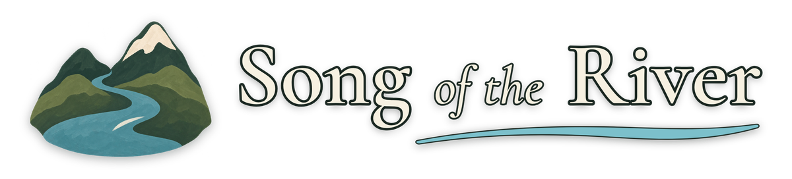
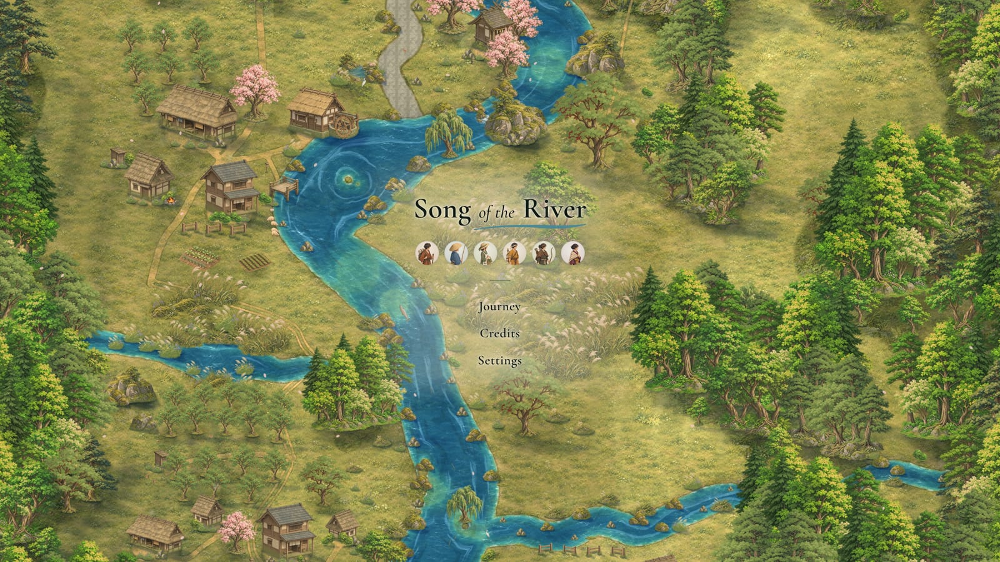
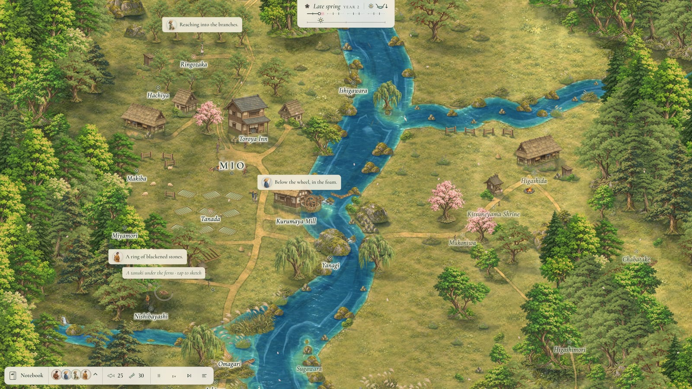
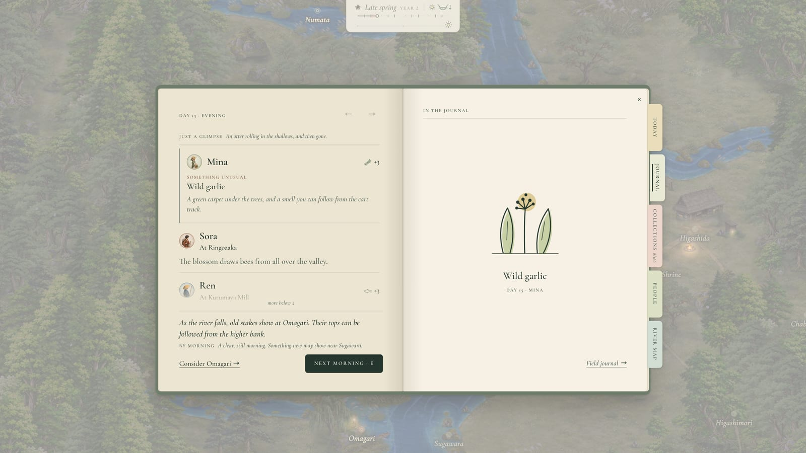

<p align="center"></p>

<p align="center"><em>Follow a river. Find a small adventure in every day.</em></p>

<p align="center"><strong><a href="https://pco2.itch.io/song-of-the-river">Play Song of the River on itch.io →</a></strong></p>

<p align="center">
  
  
  
</p>

A cosy, illustrated expedition game by **Nic Pittman (pCO₂)**, made for **Game Off 2026** (theme: *SHIFT*).

Sora leaves his mountain hut in spring to follow the river to the sea. Each morning you plan where the
companions go; through the day you watch the valley; at the evening fire you unpack what they found.
The river rises and falls, the seasons travel down the valley, and an old boat waits to be mended for
the last voyage. A second mode, **Wander**, opens the whole river at your own pace.

## Run

Requires Node 22 or later. No backend, accounts or network services.

```sh
npm ci
npm run dev        # http://localhost:5183
npm test
npm run build      # static site in dist/ with relative URLs
```

`npm run release` builds and checks the game and writes a playable ZIP to `releases/` (needs Python 3).

## Controls

| Key | Action |
| --- | --- |
| E | Send a plan, begin the day, or continue after the evening |
| R | Stay at camp, or build today, with the selected person |
| 1–6 | Choose a person while planning |
| J / B | Notebook / build and equipment |
| Arrows, WASD | Pan the valley (or scroll the notebook map) |
| Space, 1 / 2 / 4 | Pause and game speed |
| + / −, F | Zoom and frame the river |
| N, Esc | Speed through the day; close a page or menu |

Touch and mouse work throughout. Journey and Wander save separately in the browser.

## Project structure

```
src/        game source (TypeScript, Pixi.js)
public/     art, sound effects and licence texts shipped with the game
scripts/    release packaging and asset audit
media/      images for this README
```

## Licence

**Song of the River is non-commercial.** It is source-available, not open source: you may use, share
and adapt it for non-commercial purposes only. Different licences cover different parts:

| Part | Covers | Licence |
| --- | --- | --- |
| Code | Everything in `src/` and `scripts/`, and the build configuration | [PolyForm Noncommercial 1.0.0](LICENSE) |
| Art and writing | Illustrations, sprites, portraits, UI art, story and dialogue, and `media/` | [CC BY-NC 4.0](LICENSE-ASSETS.md) |
| Sound effects | `public/audio/sfx/` | CC0 / public domain, by source ([credits](CREDITS.md)) |
| Typeface | Cormorant Garamond | [SIL Open Font License 1.1](public/licenses/Cormorant-Garamond-OFL.txt) |
| Libraries | Pixi.js and other npm dependencies | Their own licences |

The music heard in the playable build is not part of this repository and is not licensed for reuse.
Commercial use of the code or the art and writing needs separate permission from the author.
Full sources and provenance are in [CREDITS.md](CREDITS.md).
